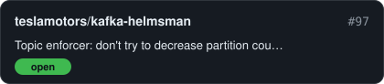

<picture>
<source media="(max-width: 600px) and (prefers-color-scheme: dark)" srcset="dist/header-mobile-dark.svg">
<source media="(max-width: 600px)" srcset="dist/header-mobile-light.svg">
<source media="(prefers-color-scheme: dark)" srcset="dist/header-dark.svg">

</picture>

I make [AI plush companions](https://getskybuds.com) for curious kids.

