<picture>
<source media="(max-width: 600px)" srcset="dist/banner-phone.svg">

</picture>

I make [AI plush companions](https://getskybuds.com) for curious kids.

<a href="https://github.com/cloudflare/lol-html/pull/344"><picture><source media="(prefers-color-scheme: dark)" srcset="dist/badges/cloudflare--lol-html-344-dark.svg"></picture></a>
<a href="https://github.com/stripe/smokescreen/pull/356"><picture><source media="(prefers-color-scheme: dark)" srcset="dist/badges/stripe--smokescreen-356-dark.svg"></picture></a>
<a href="https://github.com/cloudflare/workerd/pull/7859"><picture><source media="(prefers-color-scheme: dark)" srcset="dist/badges/cloudflare--workerd-7859-dark.svg"></picture></a>
<a href="https://github.com/cloudflare/workerd/pull/7858"><picture><source media="(prefers-color-scheme: dark)" srcset="dist/badges/cloudflare--workerd-7858-dark.svg"></picture></a>

