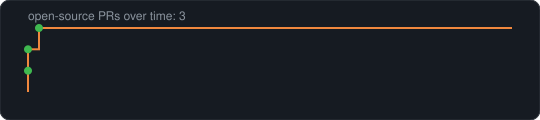

<picture>
<source media="(max-width: 600px) and (prefers-color-scheme: dark)" srcset="dist/header-mobile-dark.svg">
<source media="(max-width: 600px)" srcset="dist/header-mobile-light.svg">
<source media="(prefers-color-scheme: dark)" srcset="dist/header-dark.svg">

</picture>

## SkyBuds: talk time, not screen time

I build [SkyBuds](https://getskybuds.com): screen-free AI companion plush toys for kids ages 3 to 10.

- Just say “Hey SkyBud” and start talking: jokes, big questions and more than 75 languages.
- It answers, then asks one back, and adapts its language and topics to the child’s age.
- Bedtime stories made just for them, and a brushing song of its own.
- No camera, no screen, no ads. kidSAFE Listed, and we don’t sell kids’ data.

## Open-source missions

